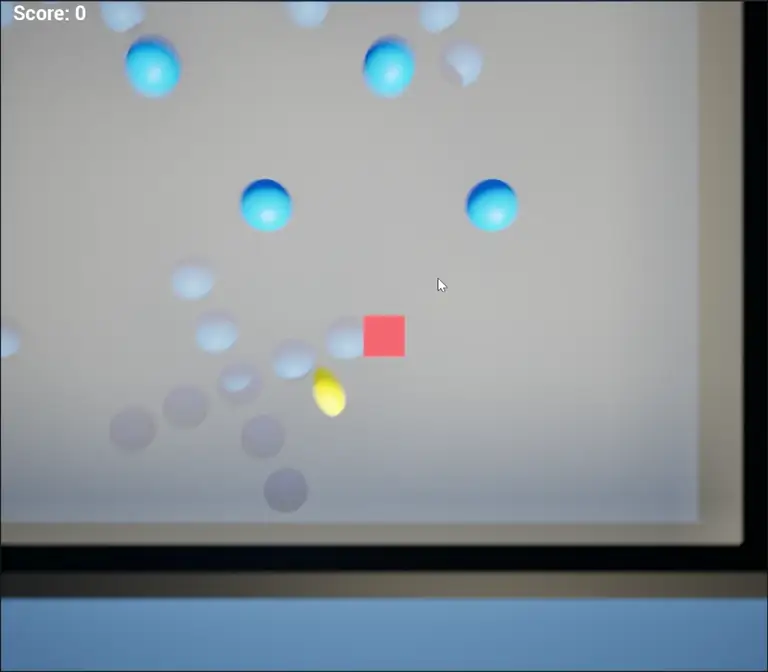

# World Hardest Game Pro

Juego de obstáculos en **Unreal Engine 5.6**. En el primer nivel, un cubo rojo esquiva esferas y reúne monedas. En el segundo, una bola atraviesa un laberinto que gira.

[Abrir el vídeo original · 23 s](docs/gameplay.mp4)

## Jugar en el editor

1. Abre [WorldHardestGamePro.uproject](WorldHardestGamePro.uproject) con Unreal Engine 5.6.
2. Pulsa **Play** desde el menú principal. Para probar una fase directamente, abre [MyLevel1](Content/Level/MyLevel1.umap) o [MyLevel2](Content/Level/MyLevel2.umap) y pulsa **Play**.
