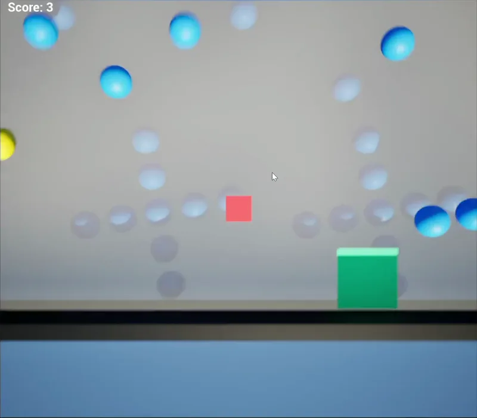
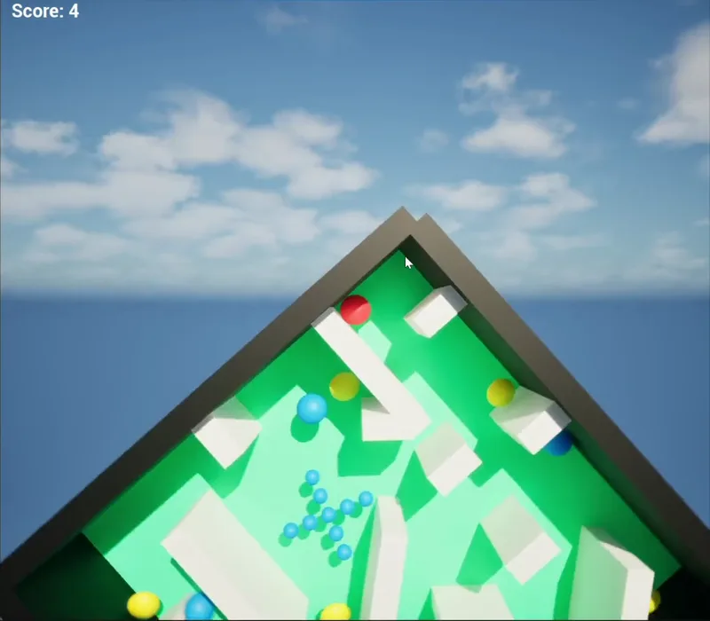

# World Hardest Game Pro

Juego de obstáculos de Chengxun Wu en **Unreal Engine 5.6**.

<strong>Nivel 1 · Esquivar y recoger monedas</strong>

El cubo rojo esquiva las esferas azules y recoge la cuarta moneda.

<strong>Nivel 2 · Laberinto giratorio</strong>

La bola roja entra en el pasillo verde mientras gira el tablero.

## Jugar en el editor

Abre [WorldHardestGamePro.uproject](WorldHardestGamePro.uproject) con Unreal Engine 5.6. Pulsa **Play** desde el menú principal o abre directamente [MyLevel1](Content/Level/MyLevel1.umap) o [MyLevel2](Content/Level/MyLevel2.umap).
