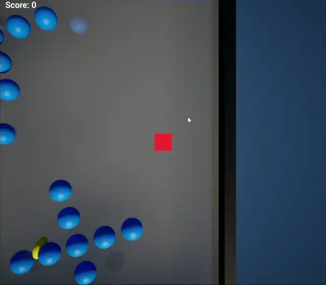
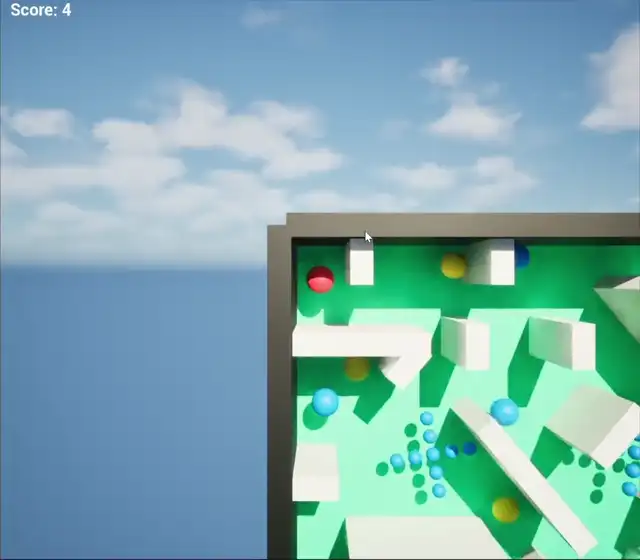

# World Hardest Game Pro

Juego de obstáculos de Chengxun Wu en **Unreal Engine 5.6**.

## Nivel 1 · Esquivar y recoger monedas

El cubo rojo cruza la plataforma, esquiva las esferas azules y recoge las monedas hasta pasar al segundo nivel.

[Ver el nivel 1 completo en MP4 · 46 s](docs/nivel-1.mp4)

## Nivel 2 · Laberinto giratorio

Una bola roja avanza por los pasillos verdes mientras el tablero gira. La grabación termina al volver al menú.

[Ver el nivel 2 completo en MP4 · 1 min 23 s](docs/nivel-2.mp4)

## Jugar en el editor

Abre [WorldHardestGamePro.uproject](WorldHardestGamePro.uproject) con Unreal Engine 5.6 y pulsa **Play** desde el menú principal. También puedes abrir directamente [MyLevel1](Content/Level/MyLevel1.umap) o [MyLevel2](Content/Level/MyLevel2.umap).
